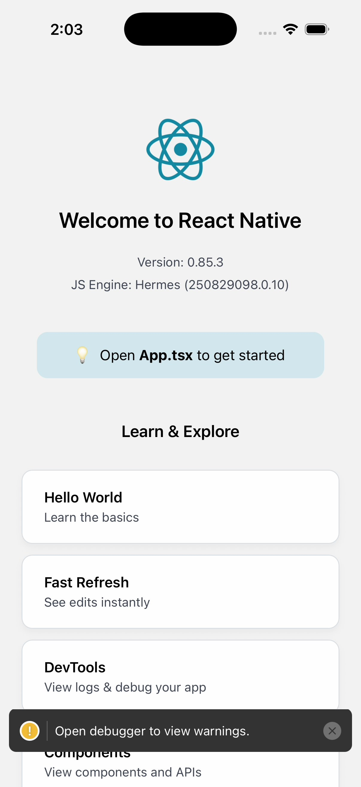
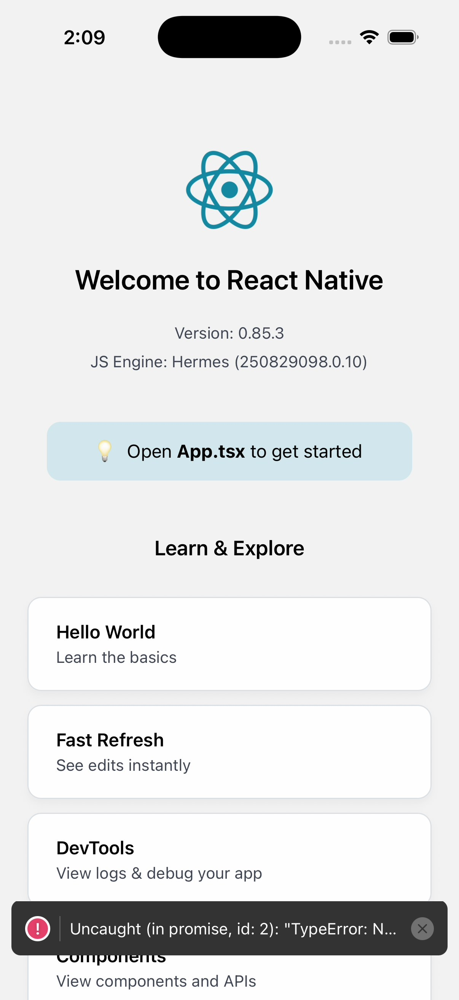

# Phase 0 feasibility report

Date: 2026-10-27

## Decision

**GO for a personal development and testing preview.** A GitHub-hosted macOS runner built and launched `MyTestApp`, streamed the simulator through a Cloudflare Quick Tunnel, and accepted simulator input through IDB. The tested stream provider is IDB's MJPEG video stream at 5 fps.

## Evidence

| Check | Result |
| --- | --- |
| Workflow run | [40435270657](https://github.com/kerolosmohsen/MyTestApp/actions/runs/40435270657) completed successfully on `macos-latest`. |
| Simulator | Dynamically selected iPhone 17; 402 × 874 logical points at 3×. |
| Simulator boot | 81 seconds from `simctl boot` through `bootstatus`. |
| Xcode build | Xcode 26.6; `xcodebuild` reported `BUILD SUCCEEDED`; the app launched with its JavaScript bundle embedded. |
| IDB and tunnel tools | `idb-cli 1.7.7`, `idb-companion 1.7.7`, and `cloudflared 2026.10.3` installed successfully. The IDB connect, launch, describe, and MJPEG stream steps passed in both successful runs ([40434137868](https://github.com/kerolosmohsen/MyTestApp/actions/runs/40434137868) and [40435270657](https://github.com/kerolosmohsen/MyTestApp/actions/runs/40435270657)). |
| Video rate | 40 ten-second server samples: mean 4.88 fps, median 4.99 fps, range 3.36–5.09 fps. The browser showed a 7.0 fps rolling reading during the live session. |
| Input response | 11 successful IDB tap commands each had a following captured simulator frame. Server-observed time from receiving a tap through IDB completion and the next frame: median 1,114 ms, mean 1,644 ms, range 746–3,149 ms. |

The tap timing starts when the Mac server receives the WebSocket message. It does not include network transit from the browser or browser image decode/display time, and the prototype did not compare image pixels to prove the first returned frame contained a visual change. Treat these figures as a server-side response measurement, not a full click-to-visible latency measurement.

Screenshots from the successful run:

## Findings and limits

- The Quick Tunnel and one-viewer WebSocket flow worked over HTTPS/WSS. The tunnel address is temporary and was deliberately not saved in this report.
- The sample app screenshot after interaction contains a React Native unhandled `TypeError` toast. The preview transport and tap command still completed; the sample app error was not diagnosed in this feasibility pass. The full workflow should collect simulator app logs so app errors can be distinguished from transport errors.
- IDB required Homebrew trust for the two Facebook formulas (`idb-cli` and `idb-companion`) on the runner. Trust was limited to those formulas; the installation then passed in 2/2 completed test runs.
- GitHub documents standard macOS runner usage as free for public repositories; private-repository minutes consume the account allowance and can incur charges beyond it. GitHub's additional product terms permit Actions for development and testing, but caution against using it as a serverless application or creating disproportionate load. Keep this tool personal, one-viewer, development-only, and time-limited; the final CLI must show the cost and policy warning before starting a session. See [Actions billing](https://docs.github.com/en/actions/concepts/billing-and-usage), [runner limits](https://docs.github.com/en/actions/reference/limits), and [GitHub Actions additional terms](https://docs.github.com/en/site-policy/github-terms/github-terms-for-additional-products-and-features).

## Recommendation

Proceed with IDB MJPEG as the primary stream and `simctl` JPEG screenshots as the fallback. Keep sessions private, single-viewer, automatically cleaned up, and capped below the six-hour GitHub-hosted job limit. The remaining measured limitation is end-to-end browser tap-to-visible latency; collect it alongside simulator logs during the final Pages-based test.
